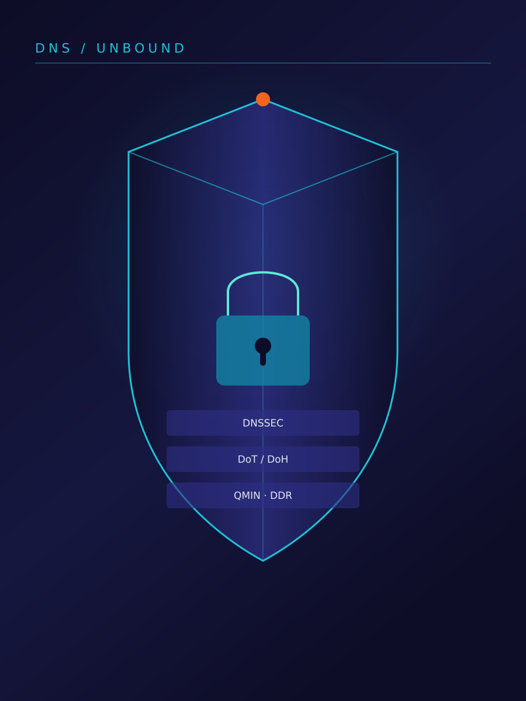

# 第三篇　加固 {.unnumbered}

{width=70%}


# 威胁模型与 NIST SP 800-81r3 基线

一次 DNS 查询从存根解析器出发，到权威服务器取回应答，中途会经过若干台你并不完全控制的机器。加固的起点不是「打开哪个开关」，而是先回答一个更朴素的问题：**这条查询，谁看得见？看见了什么？又能凭看到的做什么？**

NIST SP 800-81r3《Secure Domain Name System (DNS) Deployment Guide》给出的是一套部署基线。本章借它的骨架来组织威胁模型，但不把它读成一张打勾的合规清单。清单问的是「控制项齐没齐」，威胁模型问的是「在这条具体链路上，可见性落到了谁手里」。同一个控制，在「本地递归」和「把查询转交给上游」两种拓扑里，保护的可能是完全不同的人。落点始终是**「谁看得见什么」**。

## 为什么先谈可见性

DNS 报文里有两个东西格外值钱：一是**查询名**（你要访问谁），二是**客户端标识**（谁在问、什么时候问、从哪个地址问）。这两样合起来就是一份几乎不需要破解的浏览画像。明文 53 端口的年代，这份画像对链路上的每一跳都是敞开的自助餐；递归解析器自己因为要缓存、要过滤，也必然看得见全部查询名。

于是「加固」可以换一种说法：**把可见性从你不信任的位置，收缩到你信任的位置，并且让收缩后的那个位置无法滥用这份可见性**。三类控制——防护型 DNS、加密传输、解析验证——各自关掉的是不同观察者的一扇窗，谁也替不了谁。后面会反复回到这句话。

这一章只判断「该由哪一层负责」。各控制的参数、命令、验证与回滚分别落在第 9–14 章，RFC 的条文逻辑与协议演进在第四篇第 16、17 章，故障案例在第 22 章。

### 可见性不是一个开关

「看得见」不是有或没有，而是至少三种粒度叠在一起。把它们拆开，后面的矩阵才读得懂：

| 粒度 | 具体内容 | 谁最在意 | 哪类控制能收敛 |
|---|---|---|---|
| 内容可见 | 完整 QNAME、应答记录、EDNS 参数 | 画像者、过滤点 | 加密传输（链路上）、查询名最小化（上级） |
| 关联可见 | 客户端地址、时序、查询频率、会话连续性 | 画像者、审计方 | 转发与集中端点（把多客户端收敛成一个地址） |
| 留存可见 | 落盘后的日志、dnstap、备份与检索能力 | 日志留存方 | 保留期与访问授权（没有任何加密能替你做） |

三者的关键差别：加密传输能把**内容可见**从链路上抹掉，却基本不动**关联可见**（端点 IP、报文时序、连接时长仍然可读），更完全不碰**留存可见**。于是「链路上已经抓不到 QNAME」并不等于「查询行为不再可追踪」——时序与流量形态仍能拼出画像。这也是为什么后面矩阵要按列拆，而不是只留一列「隐私」。

反过来，**内容可见**又恰恰是防护型 DNS 的工作前提。过滤点必须读到 QNAME 才能判断该不该拦；如果为了「隐私」把查询名也从过滤点收走，过滤就一起没了。可见性治理从来不是「越少越好」，而是「把该留的那一格留对地方」。

## NIST SP 800-81r3 提供的框架

NIST SP 800-81r3《Secure Domain Name System (DNS) Deployment Guide》（第三版 / Revision 3，作者 Scott Rose、Cricket Liu、Ross Gibson）是面向「部署一套可信 DNS」的指南。它的价值在于把「安全 DNS」拆成可以逐层追问的结构：先列**资产**，再划**信任边界**，再枚举**攻击者能力**，最后才把结论落到具体部件上的**控制目标**。

按本章口径，只取这套结构，不取条目编号：

- **控制目标一律用名称表述**：「缩减暴露面」「区域数据完整性」「传输机密性」「查询元数据最小化」「上游可信」「失败关闭」等等；
- 本章**不引用任何具体控制项编号**，也不做审计项对表；编号、版本年份、修订记录与署名对应关系一律**见官方手册**（以 NIST 官方出版物页面为准），拿不准的地方不填数；
- 指南同时覆盖权威侧与解析侧两侧部署；这里只看**递归解析器 / 转发器**这一侧。

这不是把基线复述一遍。基线是「应当有什么」，威胁模型是「少了它，谁会多看见什么」。下面按资产、边界、能力三步走。

### 资产：要保护的四类对象

| 资产 | 它是什么 | 最怕什么 | 主要归哪一层管 |
|---|---|---|---|
| 区域数据（zone data） | 权威侧的应答内容，以及递归侧缓存下来的副本 | 被改、被伪造、被塞进假记录 | 解析验证 / DNSSEC |
| 解析器（resolver）本身 | Unbound 进程、配置、缓存、监听地址 | 被绕过、被劫持、被当成开放解析器 | 最小暴露面与访问控制 |
| 查询流（query flow） | 查询名、时序、客户端地址、EDNS 参数 | 被旁路复制、被聚合画像 | 加密传输 / 元数据最小化 |
| 日志（logs） | dnstap、查询日志、审计留存 | 无限期留存、越权读取 | 保留期与访问授权 |

四类资产里最容易看漏的是**日志**。查询流是「在路上」的资产，日志是「落在自己门口」的同一份资产的副本：把链路上的观察者请出去之后，如果自己在本地全量留存、又不设保留期，等于把散落的可见性收拢成一个更方便检索的集中观察者——「抗元数据聚合」在自己门口破功（集中案例见第 22 章）。资产清单里把它单列，正是为了后面把「日志留存方本身」也当成攻击者能力来建模。

区域数据还要注意「副本」二字。递归解析器并不持有权威数据，它持有一份带 TTL 的副本；缓存投毒打的不是权威服务器，正是这份副本。因此「数据完整性」在本书语境里，几乎总是指**验证器能不能识别手里这份副本被改过**，而不是「权威服务器有没有被攻破」。

### 信任边界：数据换手的三个界面

信任边界不是网线，是「这一段我认、下一段我不认」的那道线。查询每跨过一道边界，可见性的持有人就换一次。

```text
[存根解析器] --①--> [本地递归解析器 / 转发器] --②--> [上游] --③--> [权威服务器]
      |                        |
      |                        +--(加密端点)--> [日志留存方 / dnstap]
      |
      +--(客户端自带 DoH，直接跨过①)------------------> [外部 DoH 端点]

① 存根 -> 递归 -> 权威：每跳看到的 QNAME 粒度与客户端信息不同
② 本地 -> 上游：把查询「托付」给谁，就等于把可见性交给谁
③ 加密端点 -> 日志留存方：链路上看不见了，端点与日志仍看得见
```

这张图怎么读：三条编号线是**数据换手处**，不是物理链路；竖着分出去的两条是**可见性的分流处**。① 被绕过、或 ② 被悄悄改了对象、或 ③ 被忽略，都会让「我以为只有我看得见」变成别的人也看得见。

三个界面各自对应一种失守方式：

- **存根 → 递归 → 权威**：存根解析器（stub resolver）通常只发一个递归查询、把全部判断交出去；递归解析器（recursive resolver）为了完成递归，会代客户端向权威服务器（authoritative server）逐层追问。查询名最小化（QNAME minimisation）能减少发给上级的标签数，但它**不是加密**：只抗元数据聚合，不抗全路径嗅探（实测口径，参数与兼容坑在第 13 章，RFC 演进在第 17 章）。
- **本地 → 上游**：这是最容易被「配置一个字段就悄悄改掉」的边界。给转发器（forwarder）多配一个 `forward-addr`，Unbound 是并发竞速取最快应答，而不是主备，查询会被送到你并不打算托付的解析器，本地过滤表随之失效；上游超时若允许回退明文 53，整条查询流又退回裸奔（`forward-first: no` 与 fail-closed 的落地在第 5、14 章）。
- **加密端点 → 日志留存方**：DoT / DoH / DoQ 把链路加密后，端点本身成为新的可见性集中点。加密**不消灭端点可见性**，它只是把观察者从「链路上任意一跳」收敛成「你选定的那个端点 + 它的日志系统」。所以「日志留存方」必须被当成边界内的一等角色来建模，而不是运维附属品。


```text
客户端        192.0.2.10              —— 实验环境内的存根解析器
本地解析器    192.0.2.1 / 2001:db8::1  —— 自己控制的那一个端点
加密上游      198.51.100.1:853         —— resolver.example.net
权威服务器    203.0.113.53             —— dns.example.org
日志副本      本地 dnstap socket，保留期 30 天
```

为什么用文档段：地址本身就是公开示例，不会把真实拓扑带进这本 CC 许可的公开电子书。

怎么验证（一条可复制的命令）：`dig dns.example.org @192.0.2.1`。它只证明「解析通不通」，**证明不了链路上谁看得见**；可见性得靠抓包或 dnstap 去观察，二者不是一回事——这正是本章反复强调的区分。

失败模式 / 回滚点：若把示例地址误当生产地址写进配置，转发目标不可达，两波都失败即 SERVFAIL，回到 `forward-first: no` 的 fail-closed 语义（第 14 章）；此时应回滚到单上游、单一加密端点，而不是再加一个「备用」上游去竞速。

明文时，`192.0.2.10 → 192.0.2.1` 这一段上的被动观察者能读到完整 QNAME 与客户端地址；改走 `198.51.100.1:853` 后，同一观察者只剩端点 IP、端口与报文时序。可见性没有消失，只是换了持有人——这正是下一节矩阵要摊开讲的事。

### 攻击者能力清单

把「攻击者」拆成能力而不是身份，才对得上前面那三道边界。下面七项是本书后续所有加固动作的假想敌；它们并不互斥，真实故障往往是两三项叠加。

| 能力 | 站在哪道边界 | 能看见 / 能做到什么 | 对应被突破的资产 |
|---|---|---|---|
| 被动嗅探（passive sniffing） | 存根→递归、本地→上游的链路上 | 读 QNAME、时序、客户端地址，长期聚合画像 | 查询流 |
| 链路注入（on-path injection） | 同一链路，但可写 | 抢答、改应答、伪造源地址 | 区域数据副本、查询流 |
| 缓存投毒（cache poisoning） | 递归解析器的缓存 | 塞入伪造记录，污染后续所有命中 | 区域数据副本 |
| 权威劫持（authoritative hijack） | 递归→权威 | 换掉应答来源，返回「看起来正常」的假数据 | 区域数据 |
| 上游被控 | 本地→上游 | 你主动托付出去的那一端反过来骗你 | 查询流、区域数据副本 |
| 客户端绕过 | 存根这一侧 | 应用自带 DoH / 自动发现加密 DNS，跨过本地解析器 | 解析器、查询流、策略 |
| 日志留存方本身 | 加密端点→日志留存方 | 端点内部全量留存、越权查询历史 | 日志 |

三点值得单独拎出来：

1. **「上游被控」最难自查**，因为查询是你自己主动送过去的。转发器与验证器在这里二选一：把根区交给上游的转发器上再配信任锚（trust anchor），锚需要自己向根 priming DNSKEY，而 `forward-zone "."` 又把所有查询都交了出去，结果是日志持续报失败、间歇性全量 SERVFAIL（实测结论，配置取舍见第 10 章）。信任托付得越彻底，越不能假装自己还在验证。
2. **「客户端绕过」会让防护型 DNS 整体失效**，而不是削弱。策略过滤的前提是「过滤点看得见查询名」；浏览器一旦直连外部 DoH 端点，本地解析器连查询都收不到。第 13 章的 DDR 压制与浏览器侧 canary 域（回 NXDOMAIN 即表示「别启用自带 DoH」，具体域名见官方手册）处理的正是这件事，比按 IP 封 443 更准——封 IP 是 denylist，不是证明。
3. **「日志留存方本身」是加密之后才凸显的攻击者**。加密把链路观察者清掉，却没有给日志系统加任何锁；若全量 dnstap 不设保留期，攻击者不需要碰链路，只要能读日志就够了。可见性总量没变，只是搬了家。

还有一项能力容易被归错类：域外夹带的胶水记录（glue record）是经典缓存投毒面，它与 DNSSEC 签名无关，任何验证模式下都该单独挡（`harden-glue` 的开启在第 9、10 章）。把它算进「缓存投毒」这一行，而不是「权威劫持」，才不会误以为开了验证就顺带解决了它。

两项能力叠加时，最常出现两种误判：

- **「被动嗅探 + 客户端绕过」**：本地抓包看不到明文查询，便以为过滤仍在工作。实际上查询根本没经过本地解析器，是走加密通道直连外部端点；链路安静不是因为控制生效，而是因为流量换了路。判断依据应当是本地解析器有没有收到查询，而不是链路上有没有 53 端口的报文。
- **「上游被控 + 静默明文降级」**：两项分别由不同章节处理，但叠加后最难发现——上游本来就是主动托付的对象，超时后再退回明文 53，等于把被控上游的可见性又向沿途每一跳开放了一遍。第 14 章把失败路径单独拎出来做 fail-closed 工程，原因就在这里。

所以能力清单不是七个互不相干的格子。建模时至少要问一句「哪两项会一起发生」，否则容易把「某一项已被挡住」误当成「这类风险已消失」。

## 可见性矩阵：谁看得见什么

把三道边界和七项能力压到一张表里，就是本章要留下的那张图。表中「是 / 部分 / 否」指**默认明文 53、且没有额外控制时**的可见性，不是「永远如此」；后面三类控制会逐格把「是」改成「否」。

| 观察者 / 位置 | 完整 QNAME | 关联客户端 | 读应答 | 改应答 | 长期留存 |
|---|---|---|---|---|---|
| 同链路被动嗅探者 | 是 | 是 | 是 | 否 | 可自行留存 |
| 同链路注入者（可写） | 是 | 是 | 是 | 是（抢答） | 可自行留存 |
| 本地递归解析器（自己） | 是 | 是 | 是 | 技术上可以 | 取决于日志策略 |
| 上游转发目标 | 是 | 部分（只见本端地址） | 是 | 技术上可以 | 取决于对方 |
| 权威服务器 | 部分（受 QMIN 收敛） | 部分 | 是 | 可伪造 | 取决于对方 |
| 日志留存方（dnstap / 审计） | 是 | 是 | 是 | 否 | 是（若不设保留期） |
| 外部 DoH 端点（客户端绕过时） | 是 | 是 | 是 | 技术上可以 | 取决于对方 |

「客户端绕过」的特殊性不在多了最后一行，而在**「本地递归解析器」那一行会整行变空**：本地解析器连查询都收不到，过滤表、缓存、审计一起空转。可见性没有被消灭，只是从第 3 行搬到了第 7 行，搬到了你不控制的那一端。这是「防护型 DNS 与隐私控制的张力」在矩阵上的样子。

再按列看，哪一列由哪一层负责，一目了然：

- **「完整 QNAME」这一列**：加密传输把第 1、2 行清掉，查询名最小化把第 5 行收敛成「部分」；两者都**不动**第 3、6、7 行。端点自己、日志系统、外部端点依然看得见全部内容。
- **「改应答」这一列**：只有解析验证（DNSSEC）能把「是」变成「改了会被发现」。加密传输只挡得住第 2 行的链路注入，挡不住第 4、5、7 行的端点本身作恶。
- **「长期留存」这一列**：**没有任何加密或验证控制能清掉第 6 行**，只有保留期与访问授权能。这一格最容易被「我们已经全链路加密了」的错觉盖过去。

所以「加固完成」不是「表上全是否」——第 3 行那份可见性是防护型 DNS 得以工作的前提，必须保留，只是要锁在你能审计、能设保留期的那个端点上。目标是把可见性**收敛并关进笼子**，不是让它归零。这一句，就是本章与合规清单最根本的分歧。

## 三类控制的纵深关系

把基线里的控制按「关掉哪一扇窗」分成三层，比按产品功能分更不容易漏项。三者是**叠加**关系，不是**任选**关系。

### 防护型 DNS：先决定「让不让查」

防护型 DNS（protective DNS）指在解析路径上按策略过滤：拦截已知恶意域名、拒绝不该服务的来源、限制谁能用这台解析器、给应答打上本地策略。它回答的问题是**「这个查询该不该被回答」**。

关键在于：它**需要看得见查询名**才能工作。过滤点必须坐在矩阵第 3 行那个「本地递归解析器」上，且必须真的收到查询。于是它和隐私控制天然有张力——隐私要把查询名从链路上收走，过滤却要在某处把它摊开。二者不矛盾的唯一前提是：**摊开查询名的那一处，正是你信任并控制的那一处**。客户端一旦绕过，过滤表不是变弱，是整行空转。

对应章节：最小暴露面、监听地址收敛、访问控制（第 9 章）；DDR 压制与绕过检测（第 13 章）。

### 加密传输：把链路上的观察者请出去

加密传输（DoT / DoH / DoQ）做的是**传输加密与链路隐私**：把查询从明文 53 移进加密通道，顺带用证书认证「我连的是不是我要连的那个端点」。它回答的问题是**「链路上谁能看见、谁能抢答」**。

它清掉的是矩阵第 1、2 行（被动嗅探、链路注入），以及「本地→上游」这一跳的沿途观察者。它**不清掉**第 3、4、6、7 行：端点自己、上游自己、日志系统、外部端点仍然看得见全部内容。所以「上了 DoH 就隐私了」是错的——更准确的说法是「把观察者名单从『任意一跳』缩短为『我选定的端点及其日志方』」。

还有一个容易反噬的边界：加密通道如果允许失败后回退明文 53，前面清掉的第 1、2 行会原样回来，而且往往静默发生。`forward-first: no` 与 fail-closed 的取舍就是把这条退路堵死（第 5、14 章）。审计时先问失败路径，再问正常路径，原因就在这里。

### 解析验证：确认「答案是不是原样的」

解析验证（DNSSEC validation）由验证器（validator）从信任锚（trust anchor）出发逐级验签，做的是**数据完整性与来源认证**：应答有没有被改过、是不是这个区域真正签发的。它回答的问题是**「这份数据我能不能信」**。

它针对的是矩阵里「改应答」那一列：缓存投毒、权威劫持、上游被控，以及端点本身返回的假数据。这些恰恰是加密传输**管不到**的——加密只保证「路上没人动」，不保证「出发时就是对的」。反过来，DNSSEC 也一个字节都不隐藏：签过名的应答仍是明文可读的完整 QNAME，链路上照样能画像。

验证还有状态之分：没有信任锚就是透传不验证（坏签名域照样返回答案），permissive 只记录日志仍放行，真验证才会把坏签名变成 SERVFAIL、给好签名打 AD 标志；「有锚却主动允许降级」这类设置会自己制造漏洞。三种状态与相关开关在第 10 章。另外，`harden-below-nxdomain` 只对 DNSSEC-secure 的 NXDOMAIN 生效，没有验证器时它是空转——别把「开关已打开」误判成「控制已生效」（见官方手册对应 NOTE，配置在第 10 章）。

### 三者如何叠加而不互相替代

| 控制层 | 回答的问题 | 关掉的观察者 / 能力 | 明确管不到的 |
|---|---|---|---|
| 防护型 DNS | 该不该回答 | 客户端绕过、未授权来源 | 链路可见性、应答真伪 |
| 加密传输 | 链路上谁看得见 | 被动嗅探、链路注入 | 端点作恶、日志留存、数据伪造 |
| 解析验证 | 数据能不能信 | 缓存投毒、权威劫持、上游被控 | 元数据画像、日志留存 |

「纵深」的意思在这张表里很清楚：三行的**最后一列互不重叠**。少任何一层，都对应着一类攻击者能力完全没人接管——不是「防护变薄」，是「那一格是空的」。而「不互相替代」也在这里落地：拿加密传输去挡缓存投毒，或拿 DNSSEC 去挡被动嗅探，都是把控制放错了列。

## 一条不能含糊的分界线

全书只认这一组定义，任何章节都不许混用：

> **DNSSEC = 数据完整性 + 来源认证**（应答没被改、且确实由该区域签发）。
> **DoT / DoH / DoQ = 传输加密 + 链路隐私**（路上不可读、不可抢答、端点可认证）。
> **二者不互相替代**：前者不隐藏一个字节，后者不校验一个签名。

两条常见的错认，正好对应两种坏结果：

- **「我们已经上了 DoH，DNSSEC 可以省了」**：链路确实干净了，但上游被控、权威劫持、缓存投毒这三项全都还在。加密通道会把一份伪造应答完好无损、加密地送到客户端手里——「路上没人动」反而让伪造更难被察觉。
- **「我们开了验证，就不用管传输了」**：应答确实可信了，但完整 QNAME、客户端地址、时序在每一跳明文可读，查询流与日志两列一个「是」都没少。签名不提供保密性。

判断某个新机制属于哪一类，只需问一句：**它改的是矩阵里「改应答」那一列，还是「完整 QNAME / 关联客户端」那一列？** 改前者的是验证族，改后者的是加密族，两列都改的目前没有。查询名最小化常被误当成加密，就是因为它只碰「权威服务器那一行的 QNAME 粒度」，既不给链路上锁，也不给应答签名（协议条文见第四篇第 17 章）。

一句话收束：加密传输决定**谁看不见**，解析验证决定**看见了也改不了**，防护型 DNS 决定**该不该让它被看见**。三句话里没有一句能由另外两句推出来。

## 控制目标 → 本书章节

下表把基线里的**控制目标名称**（不带编号）对到第三篇后续各章。左列是「要达成什么」，中间两列刻意保留威胁模型口径——你要能说清这个目标**把可见性从谁手里拿走、又挡住哪项能力**，否则就只是在抄清单。具体控制项编号、审计映射与版本对应关系**见官方手册**。

| 控制目标（名称，无编号） | 收敛的可见性 | 主要挡住的能力 | 本书章节 | 该章标题 |
|---|---|---|---|---|
| 缩减暴露面与访问授权 | 谁能向解析器提问 | 未授权使用、被当开放解析器 | 第 9 章 | 最小暴露面与访问控制 |
| 区域数据完整性与来源认证 | 谁能改应答而不被发现 | 缓存投毒、权威劫持、上游被控 | 第 10 章 | DNSSEC 验证：信任锚、放行与拒绝 |
| 传输机密性与服务端点认证（DoT） | 存根→递归、本地→上游链路 | 被动嗅探、链路注入 | 第 11 章 | DoT：端口 853 的服务端与客户端 |
| 加密查询的承载与共存（DoH） | 与 Web 共端口时的链路 | 被动嗅探、按端口封锁 | 第 12 章 | DoH：与 Web 服务共存的加密解析 |
| 查询元数据最小化与防绕过 | 上级看到的标签数、客户端是否绕过 | 元数据聚合、客户端绕过 | 第 13 章 | 查询隐私：QMIN、防降级与 DDR 压制 |
| 上游可信与失败关闭 | 本地→上游的托付对象、失败后的退路 | 上游被控、静默明文降级 | 第 14 章 | 加密通道选路与 fail-closed 工程 |

三点读表提示：

1. **第 9、13 章看起来「不像安全章」，其实管的是可见性的入口**：一个决定谁能进来问，一个决定客户端会不会干脆不进来。少了它们，第 10–12 章的控制连流量都碰不到。
2. **第 10 章单独占住「数据完整性」这一列**，不与第 11、12 章合并，正是那条分界线的编排结果：验证与加密在本书里永远分章，参数也互不借用。
3. **第 14 章是唯一处理「失败之后」的一章**。威胁模型里最阴的往往是降级路径——控制都在，但超时之后悄悄退回明文 53，等于把整张矩阵复原。单上游、fail-closed、两波失败即 SERVFAIL，说的都是同一件事：不给可见性留一条偷偷搬家的退路。

表中没有「合规通过」这一列。一个目标是否达成，判断标准不是「配置项写没写」，而是回到矩阵问：这一格现在的持有人，是不是我信任、能审计、且留不久的那一个。

## 把基线读成问题，而不是清单

合规清单的读法是「逐项确认已配置」，威胁模型的读法是「对每一跳追问四个问题」。合上本章前，不妨拿自己那台解析器过一遍：

1. **这条查询现在落在矩阵的第几行？** 也就是：完整 QNAME 此刻在谁手里。
2. **我信任那个持有人吗？** 不信任却把查询托付过去（多一个 `forward-addr`、外部 DoH、上游递归），就是「上游被控」的入口。
3. **它能不能改应答？** 能改的话，是 DNSSEC 在拦，还是我误以为加密传输会拦。
4. **失败之后会退到哪里？** 退到明文 53、退到第二个竞速上游、退到客户端自带解析器，都意味着可见性搬了家而不是消失。

再补两问，专门针对最容易被漏掉的两格：**日志留存方是谁、保留多久**（第 6 行），以及**客户端有没有办法绕开我**（第 3 行会不会整行变空）。这两格没有任何加密或验证控制会替你关掉，只能靠保留期、访问授权与绕过检测。


| 跳转 | QNAME 此刻在谁手里 | 我信任它吗 | 它能改应答吗 | 失败后退到哪里 |
|---|---|---|---|---|
| `192.0.2.10 → 192.0.2.1` | 存根与本地解析器 | 是（自己控制） | 技术上可以，靠本地审计约束 | 客户端自带 DoH（须压制） |
| `192.0.2.1 → 198.51.100.1:853` | 加密上游端点 | 取决于托付关系 | 可以，靠解析验证兜底 | 明文 53（须堵死） |
| 递归 → `203.0.113.53` | 权威服务器 | 不一定 | 可以，靠签名识别 | 换上游（须单上游） |
| 本地 → dnstap | 日志留存方 | 是，但需限权 | 否 | 无限期留存（须设保留期） |

四行里没有一行是「没人看得见」。第一行是主动保留的可见性，第二、三行靠验证与单上游约束，第四行靠保留期约束。差别只在「持有人是谁、能留多久」——这就是把清单读成问题之后，剩下的全部工作。

于是整章可以压成一句：**加固不是把「谁看得见什么」改成「没人看得见」，而是改成「只有我信任、且我能审计的那一个端点看得见，并且它看见了也改不了、留不久、别人绕不过去」。** 第 9–14 章各把这句话里的一个分句落到配置与验证命令上。

## 本章要点

- 本章借 NIST SP 800-81r3 的「资产 → 信任边界 → 攻击者能力 → 控制目标」骨架建模，只读控制目标名称、不引用控制项编号；版本年份、编号与审计映射见官方手册。
- 四类资产（区域数据、解析器、查询流、日志）里最易漏的是日志：它是查询流在自己门口的副本，加密之后会变成新的集中观察者。
- 三道信任边界（存根→递归→权威、本地→上游、加密端点→日志留存方）各对应一种失守方式；可见性每跨一道边界就换一次持有人。
- 防护型 DNS、加密传输、解析验证是叠加而非任选：分别回答「该不该回答」「链路上谁看得见」「数据能不能信」，三者管不到的那一格互不重叠。
- DNSSEC = 数据完整性与来源认证，DoT / DoH / DoQ = 传输加密与链路隐私，二者不互相替代；加密不校验签名，签名不隐藏字节。
- 落点是「谁看得见什么」：目标不是让可见性归零，而是把它收敛到可信任、可审计、有保留期、且客户端绕不过的那一个端点。

## 参考资料

- NIST SP 800-81r3《Secure Domain Name System (DNS) Deployment Guide》官方出版物页面：<https://csrc.nist.gov/pubs/sp/800/81/r3/final>
- NIST CSRC 出版物总目（版本年份、修订记录与署名以此为准）：<https://csrc.nist.gov/publications>
- RFC 4033, *DNS Security Introduction and Requirements*：<https://www.rfc-editor.org/rfc/rfc4033>
- RFC 7858, *Specification for DNS over Transport Layer Security (TLS)*：<https://www.rfc-editor.org/rfc/rfc7858>
- RFC 8484, *DNS Queries over HTTPS (DoH)*：<https://www.rfc-editor.org/rfc/rfc8484>
- RFC 9250, *DNS over Dedicated QUIC Connections*：<https://www.rfc-editor.org/rfc/rfc9250>
- RFC 5737, *IPv4 Address Blocks Reserved for Documentation*：<https://www.rfc-editor.org/rfc/rfc5737>
- NLnet Labs Unbound 官方文档（各控制的参数与验证以此为准）：<https://unbound.docs.nlnetlabs.nl/en/latest/>
